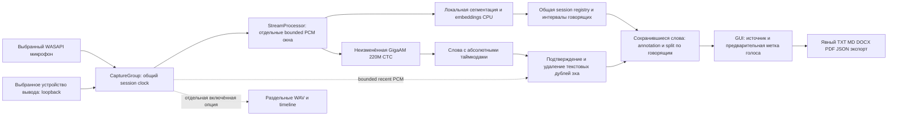

# Устройство приложения v0.2.0

Основа скопирована из MIT-проекта gigaam-local-meeting-transcriber, commit `6f43fdd292f54234e6abbd51b0f97ea0aba93bea`, в отдельный репозиторий. Исходный проект не изменён. Аккаунтов встречи, бота, Teams/Zoom API/SDK, Docker и сервера нет.

## Ответственность компонентов

- `audio.py` — Windows WASAPI, выбор устройств, downmix внутри источника, общий монотонный clock с паузами и явные ошибки.
- `streaming.py` — bounded buffers/queue, context windows, единый inference worker, ownership границ и сохранность Word timestamps. Диаризация работает на том же PCM/clock; её ошибка сохраняет ASR текст с неопределённой меткой.
- `engine.py` — прежняя закреплённая GigaAM Multilingual CTC CPU float32, локальные hash-checked веса. Не вызывается model hub loader.
- `diarization.py` — локальные ONNX модели CPU, акустические features, общая registry, bounded history интервалов и annotation каждой Word. Номер источника не используется как личность.
- `echo.py` — консервативное подтверждение PCM/text/time; изменения только текста. Сохраняет tuple Word и будущие metadata.
- `session.py` — новый registry на Start, сохранение его через Pause, model validation до открытия потоков, echo→annotation, отображение late updates, drain→finalize→finished.
- `contracts.py` — неизменяемые AudioBlock, Word, Segment и SpeakerTurn; source и speaker отдельны.
- `gui.py` — русский интерфейс, consent, явные Start/Pause/Stop, toggle, оценка числа голосов, provisional/unknown/overlap.
- `exports.py` — атомарное exclusive сохранение пяти форматов. JSON содержит точные Word records; embeddings и аудио не экспортируются.
- `offline.py` — запрет Python network operations до dependency imports; не замена OS Firewall.

## Ограничения памяти и результата

Нет full-meeting PCM archive в обычном режиме. PCM живёт в 48-секундной общей очереди, ограниченных драйверных/echo buffers и одном активном окне. История speaker turns и количество голосовых centroids ограничены. Текст, Word metadata и экранные реплики накапливаются до явного окончания/экспорта: их размер зависит от длительности.

Stop не выполняет full-recording acoustic reclustering. IDs сохраняются; supported provisional labels становятся finished, ambiguous labels остаются неизвестными. Это fragment-based diarization с явными ограничениями, а не обещание точной непрерывной диаризации.

Сегментация и CTC timing приблизительны. Одновременные голоса внутри одного источника не разделяются на два независимых текста. Полный AEC и реальные имена не вычисляются. Подробности: [DIARIZATION.md](DIARIZATION.md), [PRIVACY.md](PRIVACY.md), [TESTING.md](TESTING.md).